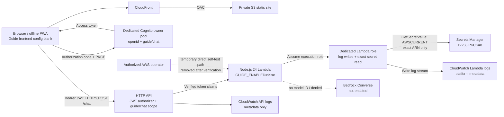

# AI Travel Guide

## Architecture Decision

The existing static S3/CloudFront PWA remains the application. A separately,
manually provisioned API Gateway HTTP API uses a JWT authorizer and a Node.js 24
Lambda calling Bedrock Runtime Converse with a bounded tool loop. No database,
framework, package manager, application build or persistent server memory is added.
Lambda uses its runtime-included AWS SDK v3; local tests inject a mock Converse
function and never invoke a model. Bedrock Agents Classic is not selected for a
new customer. AgentCore Runtime/Harness are supported alternatives, but add session
and runtime infrastructure unnecessary for this short, browser-context tool loop.

The browser's existing planned/actual storage is authoritative. Every message sends
a fresh, bounded trip snapshot, not the entire localStorage object. The server
can only return recommendations and validated proposals; it never writes browser
storage. Apply requires a user click and revalidation against the latest snapshot.
Flights, hotels, work and ferry events cannot be changed by AI. Manual itinerary
editing remains available independently. Changes use existing actual-plan buckets.

## Official References Checked 16 October 2026

- [Converse](https://docs.aws.amazon.com/bedrock/latest/userguide/conversation-inference.html)
- [Tool use](https://docs.aws.amazon.com/bedrock/latest/userguide/tool-use.html)
- [AgentCore](https://docs.aws.amazon.com/bedrock-agentcore/latest/devguide/what-is-bedrock-agentcore.html)
- [Nova Lite model/regions](https://docs.aws.amazon.com/bedrock/latest/userguide/model-card-amazon-nova-lite.html)
- [HTTP API JWT authorization](https://docs.aws.amazon.com/apigateway/latest/developerguide/http-api-jwt-authorizer.html)
- [Lambda integration](https://docs.aws.amazon.com/apigateway/latest/developerguide/http-api-develop-integrations-lambda.html)
- [Lambda runtime SDK](https://docs.aws.amazon.com/lambda/latest/dg/lambda-nodejs.html)

AWS lists Converse and tool use for Nova Lite, and Mumbai as a source region for
`apac.amazon.nova-lite-v1:0`. This is APAC cross-region inference, NOT guaranteed
Mumbai-only processing. Account entitlement and invocation access require separate
verification; the public regional listing alone does not prove access.

No resources are created by application scripts. Existing hosting, OIDC trust and
deployment credentials must not be replaced or bypassed. Manual prerequisites and
verification steps below must be completed before enabling the public configuration.

## Verification Status

Pre-setup readiness snapshot refreshed on 16 October 2026 using read-only AWS
metadata queries. The Stage 1 execution record below supersedes resource-presence
statements in this initial snapshot. Observations apply to account `176515272004`, source region
`ap-south-1`, not every region or an undeployed proposed execution role.

- `get-distribution-config` verified distribution `EV423THGIU6DJ`, existing S3
  origin `perthplannerproduction-sitebucket397a1860-wzqmjci6w9tn`, OAC
  `E1E1RHCJ5T3SSL` and HTTP-to-HTTPS redirect. Reuse this hosting.
- The previously timed-out S3 inspection was resolved on 16 October 2026:
  `get-public-access-block` with explicit expected owner `176515272004`, region
  `ap-south-1` and a 30-second read timeout returned all four flags true
  (`BlockPublicAcls`, `IgnorePublicAcls`, `BlockPublicPolicy`,
  `RestrictPublicBuckets`). No S3 setting was changed.
- `get-inference-profile` returned ACTIVE for `apac.amazon.nova-lite-v1:0`, ARN
  `arn:aws:bedrock:ap-south-1:176515272004:inference-profile/apac.amazon.nova-lite-v1:0`,
  and the six destination foundation-model ARNs listed below.
- `get-foundation-model-availability` returned AUTHORIZED, agreement AVAILABLE,
  entitlement AVAILABLE and region AVAILABLE. This confirms current account
  access, not the permissions of a future Lambda role or a successful Converse call.
- `get-apis` returned two DrawApi HTTP APIs. `list-functions` returned Draw
  application/maintenance functions, not a Perth Travel Guide backend. Do not
  attach this guide to unrelated application resources merely to avoid creating one.
- `list-user-pools` returned two AdminUserPool pools. No Perth-specific pool was
  identified. Ownership, app clients, scopes and suitability of those pools remain
  unverified; do not assume they are reusable or configure them without approval.
- The v16 baseline hardening checks passed: 26 guide/security/contract tests, 8 deployment tests, eight JavaScript
  syntax checks, and the independent Chromium offline/mobile/chat/location suite.
  Deployment tests include the mocked guide suite and fixture-only HTTP release
  verification. No current test failures were observed.

**Not ready to enable:** endpoint/OAuth/public-key fields remain unconfigured.
Local hardening reconciles commitments with the shared server-owned baseline,
checks trusted gateway issuer/client/access-token/expiry/scope/owner claims before
the disabled-mode gate, and binds proposal/confirmation/apply with signed receipts.
Stage 2A below verifies real Cognito sign-in and selected API Gateway/Lambda auth
paths. JWT cryptographic verification belongs to API Gateway, not Lambda claim
comparisons. Secret retrieval/public-key matching, SDK execution and inference
are now distinguished in the Stage 2B record below. The real signing-secret
retrieval, runtime SDK loading, P-256 pin validation and cache refresh passed;
failure paths remain locally mocked. Bedrock inference remains unverified and
disabled.

## Stage 1 Execution Record: 19 October 2026

The user approved dedicated resources only, deferred all signing-key creation and
storage, and later approved continuing without reserved concurrency after AWS
rejected the request. No Draw resource was reused. No Bedrock permission, invocation,
frontend endpoint configuration, CSP/CloudFront change, alarm, owner user, secret,
production key, owner `sub` or AI activation was added.

| Resource | Created/Verified Value |
| --- | --- |
| Cognito owner pool | `ap-south-1_zfmILMJeW`, `perth-travel-guide-owner`; admin-create-user only, self-sign-up disabled, zero users. |
| Resource server | `guide` / scope `guide/chat`. |
| Public SPA app client | `61nc44talahtbrccuohb422b2v`, `perth-travel-guide-spa`; no client secret; code flow only; `openid guide/chat`; exact CloudFront callback/logout; 15-minute access token; token revocation enabled. |
| Cognito domain | `perth-planner-guide-176515272004`, ACTIVE on the dedicated pool. |
| HTTP API | `hrgofici70`, `https://hrgofici70.execute-api.ap-south-1.amazonaws.com`; exact CloudFront CORS, POST/OPTIONS, Authorization/Content-Type, no credentials. |
| JWT authorizer | `7kd1wq`; Authorization-header source; exact new pool issuer and public client audience; required `guide/chat` route scope. |
| Lambda integration/route | `a4f8tn7`, payload v2.0, 28-second integration timeout; only `POST /chat`, JWT-authorized. |
| Lambda invoke policy | `apigateway-perth-travel-guide-post-chat`; exact new API `$default/POST/chat` SourceArn and account condition. No Lambda function URL exists. |
| Stage | `$default`, auto-deploy; metadata-only access logs and best-effort 0.2 request/sec, burst 2 route throttle. |
| Lambda | `arn:aws:lambda:ap-south-1:176515272004:function:perth-travel-guide`, Node.js 24, 28 seconds, `GUIDE_ENABLED=false`. Issuer/client/origin are configured. `ALLOWED_SUB`, secret ARN/public pin and Bedrock model ID are absent. |
| Runtime role | `arn:aws:iam::176515272004:role/perth-travel-guide-runtime`, Lambda-only trust. Final inline policy grants only dedicated Lambda log-stream writes. No Bedrock, S3, secret, IAM-admin or self-invoke permission. |
| Log groups | `/aws/lambda/perth-travel-guide` and `/aws/apigateway/perth-travel-guide`, both seven-day retention. |
| Signing secret/key | Not created. Exact secret name is absent; no value/key was generated or retrieved. |

**Verification performed:** read-back verified Cognito/API/Lambda/role/stage/log
settings. API missing-token and malformed bearer probes each returned 401; access logs
show `integrationStatus:"-"` and `integrationLatency:"-"`; Lambda Invocations had
no datapoints for that probe interval. Exact-origin CORS OPTIONS returned 204 with
the configured origin/methods/headers. IAM simulation after removing the premature
secret-prefix grant returned implicit DENY for both secret read and Bedrock invoke.
No Bedrock call was made.

After Stage 1, local verification reran **30 guide/security tests, 8 deployment/
package tests, 8 syntax checks and the Chromium PWA suite**. All passed. Chromium
uses mocked Cognito/API/Secrets Manager/Bedrock/geolocation, not the new AWS API.
The real AWS observations above are separately identified and do not upgrade those
mock results into live integration coverage. No current source/workflow diff changes
the existing GitHub Actions file or shared deployment policies; the static package
gate still excludes backend/docs/tests.

**Not verified:** no owner account/token exists; valid-owner disabled-mode HTTP test
is therefore not possible yet. Expired/wrong-issuer/wrong-audience JWT cases were not
tested against a real signed token. Secret retrieval/public-key match, SDK runtime
calls, signed proposal flow and APAC inference were not exercised in AWS. Existing
alarm list is empty; no cost alerts/alarms were created. Existing CloudFront still
has no CSP; no frontend policy/deployment change was made. Reserved concurrency is
unset; account setting was 10/10 unreserved, and the attempt to reserve 1 failed.
An AWS quota request for 11 was rejected because the Service Quotas API required a
value above its reported 1000 default. The user approved proceeding without this
per-function cap. The 0.2/2 API throttle is best-effort, not a spending ceiling.

IAM simulation confirmed the setup operator is in the account `admin` group and has
identity-based `lambda:InvokeFunction` permission. The Lambda resource policy grants the API only,
but account administrators can generally grant/invoke directly. Do not delegate
admin credentials; gateway tests prove public-route rejection, not resistance to a
malicious AWS administrator fabricating a Lambda event. At the end of Stage 1,
the disabled/missing-owner configuration failed closed.

## Stage 2A Authenticated Disabled-Mode Verification: 19 October 2026

Created the intended owner account in the dedicated admin-created-only pool and
completed a real Cognito authorization-code/PKCE sign-in. Three short-lived,
no-secret localhost test clients were created and then deleted; one was removed
without completing its callback probe. The production SPA
client settings were not changed. Access tokens were exchanged and used only in
memory; no token was printed, and AWS access logs and repository artifacts exclude
tokens and authorization codes.

| Probe | Observed result |
| --- | --- |
| Missing or malformed bearer token | API Gateway returned 401 before Lambda (`integrationStatus`/`integrationLatency` absent). |
| Valid Cognito token with an audience excluded from the authorizer | API Gateway returned 401 before Lambda. |
| Valid owner token with a deliberately nonmatching Lambda owner allowlist | Lambda returned 403, `Travel Guide owner access required.` |
| Valid owner token with the restored owner allowlist while chat was disabled | Lambda returned 503, `Travel Guide is unavailable.` This confirms authenticated routing to the disabled handler, not model execution. |
| Exact-origin CORS preflight | API Gateway returned 204 with the configured origin/methods/headers. |

Access logs for these probes contain request ID, route, status, integration status/
latency and response length only; no headers, token, body or chat content. After
testing, Lambda was restored to the production client ID and exact owner `sub`,
`GUIDE_ENABLED=false`, and the JWT authorizer to the production audience only.
All temporary clients were confirmed deleted; only the original production client
remains code-flow-only with no client secret and its CloudFront callback/logout
URLs. The owner `sub` value is intentionally omitted from this record.

No signing secret/key, public-key pin, Bedrock model setting or Bedrock IAM
permission was added. No Secrets Manager read, Bedrock invocation, frontend
configuration/deployment or public-site change occurred. Reserved concurrency
remains unset. The guide remains disabled.

**Still unverified against AWS:** wrong-issuer, invalid-signature and ID tokens;
wrong-origin requests; live signed
proposal/confirmation; secret retrieval and public-key matching; Lambda SDK/model
execution; and Bedrock inference. These remain separate gates before any approved
activation.

### Stage 2A Follow-Up: Scope And Natural Expiry

On 19 October 2026, read-only inspection verified the same production client,
single JWT audience, exact issuer/owner and required `guide/chat` route scope.
Lambda remained `GUIDE_ENABLED=false`, without model or secret configuration.
Its runtime role retained only dedicated log-stream writes, with no attached
policies. No AWS resource or configuration was changed for this follow-up.

The unchanged production client was used for genuine code/PKCE exchanges with
the registered CloudFront callback. A local helper exchanged codes, verified
RS256 signatures against the dedicated pool's JWKS and retained tokens only in
memory. No token or code was printed or persisted. Browser interception was not
reliable; the callback was instead handed to the loopback helper from the test
tab after clearing code/state from the visible address. No frontend release was
made and no temporary Cognito client was needed.

| Case | Result And Rejecting Layer | Sanitized Evidence |
| --- | --- | --- |
| Insufficient scope | PASSED: real owner access token requested with `openid` only, without `guide/chat`; API Gateway returned 403 before Lambda. | Code exchange 200, RSA signature verified; request `FetZgiTqBcwEMpw=` at 07:11:31 UTC; access log status `403`, integration status/latency `-`/`-`, response length 23. Earlier equivalent request `Fes3OjYwBcwEJ1Q=` was also rejected at the gateway. |
| Full-scope owner before expiry | PASSED: real owner token returned the safe disabled Lambda 503. | Request `FetY1jRwhcwEMkw=` at 07:11:27 UTC; access log status `503`, integration status `200`, latency 319 ms, response length 40. Response was exactly `{"error":"Travel Guide is unavailable."}`. |
| Expired token | PASSED: the same full-scope token that received the owner 503 was retained unchanged until natural expiry; API Gateway returned 401 before Lambda. No refresh, fabricated JWT or clock manipulation was used. | The helper's completed result recorded signed `exp` 07:26:25 UTC and the actual single probe at 07:26:56 UTC. Request `FevqDhRlhcwEJWg=` returned `401`; correlated access log has integration status/latency `-`/`-`, response length 26. This is the observed response, not an inference from the schedule. |
| Wrong issuer | DEFERRED: no approved controlled distinct issuer/token is available. No request was sent; status, rejecting layer and invocation evidence are unavailable. | Draw pools are not approved test issuers. Smallest follow-up: provide an approved distinct-issuer token privately to the local test process, or separately approve a disposable dedicated test pool/client and its cleanup. Do not broaden the Perth authorizer. |

For the inspected interval starting 07:05 UTC through the completed expiry check,
all four API access-log records contained only the six configured metadata fields.
The Lambda log count remained four records, containing platform
START/END/REPORT/INIT metadata only, with no additional invocation for the expired
or insufficient-scope tokens. No bearer/JWT, private-key
or location-field markers were found; no coordinates or secrets were supplied.
IAM simulation of the runtime role's `bedrock:InvokeModel` on the profile returned
`implicitDeny`; this is not a model invocation or an account-wide invocation audit.
No Bedrock invocation occurred in these tests: Lambda remained disabled and had
no model ID or Bedrock permission, and the expired/scope requests were rejected
before Lambda. The test requests used `{}` and neither contained an itinerary nor
performed an Apply/write operation, so no itinerary mutation occurred.
The disabled owner request returned before secret/model work, and the scope and
expiry requests never reached Lambda. All API responses were fixed errors.
Local planner storage was empty when checked before expiry; its tab was no longer
shared for the final comparison, so a before/after storage-hash check is not
claimed. Cross-origin/device storage is not an authoritative server-side itinerary
audit. Final AWS readback confirmed the same code hash, production-only JWT
issuer/audience, `GUIDE_ENABLED=false`, and absent model/secret configuration.

Cleanup verified: the probe completed and its loopback listener on port 9878 is
stopped; the token existed only in the terminated process's memory. No AWS
configuration rollback is required. Clear/close the isolated test tab; the ignored
helper contains no signing key or credential. No frontend deployment, commit or
push occurred. Wrong issuer remains explicitly deferred, so full Stage 2A JWT
coverage is not claimed. Stage 2B is recorded below.

## Stage 2B Signing Secret Execution Record: 23 October 2026

Created the dedicated signing secret after approval. The private P-256 key was
generated with Node.js native crypto in process memory and sent directly to
Secrets Manager with the AWS SDK. It was never written to a file, command line,
source, ZIP, output or log. The generated public fingerprint is recorded below;
the private value is not.

| Item | Verified result |
| --- | --- |
| Secret | `arn:aws:secretsmanager:ap-south-1:176515272004:secret:perth-planner/travel-guide/proposal-signing-6qL2lF` |
| Encryption/rotation | AWS-managed `aws/secretsmanager` key; automatic rotation disabled; current version has `AWSCURRENT`. No separate KMS runtime grant. |
| Runtime IAM | Only `secretsmanager:GetSecretValue` on the exact ARN was added. IAM simulation: exact secret read allowed; secret write, unrelated secret read and Bedrock `InvokeModel` implicitly denied. Existing dedicated log-stream writes retained. |
| Public-key thumbprint | `LBKG8Of60ycPuUxEGoazrqLfTRezqJFhSfDw8i5MqBE` (RFC 7638 SHA-256, base64url). Public JWK is configured on Lambda; no private JWK component is configured. |
| Actual Lambda test | Node.js 24 `backend/guide.handler` loaded its runtime Secrets Manager SDK, retrieved the secret via the execution role, accepted current-version metadata, validated PKCS#8 P-256, and matched the derived public JWK to the pin. Direct response: `ready`, `ec`, `prime256v1`, matching thumbprint. |
| Cache behavior | One direct invocation observed an immediate cache hit, waited 61 seconds, then performed a second Secrets Manager read after expiry. Actual response reported `cacheHit=true`, `cacheExpiredAndRefreshed=true`, `secretReadCount=2`; elapsed time 64 seconds. |
| Failure scenarios | Local mocks only: access denied/not found/timeout, malformed metadata/PEM, wrong curve/pin, and no stale-key use after expired-cache retrieval failure. All fail closed with generic errors; no Bedrock call. No production secret corruption or IAM denial was induced. |
| Final Lambda state | Clean backend code hash `N8IbU5eOEcq+Yo4d9O468igwKKYQaFdIkAJmz4DkWCc=`; timeout restored to 28 seconds; self-test branch/flags removed; `GUIDE_ENABLED=false`; no model ID. Secret ARN and public pin retained. |

The test ZIP contained only `backend/guide.cjs`, `backend/security.cjs`,
`guide-contract.js` and `data.js`; scans found no private payload. The final clean
ZIP has the same four files and no self-test marker. CloudWatch contained only
Lambda START/END/REPORT platform records for the direct tests; sensitive-marker
scanning found no PEM, token or location values. No CloudTrail trail/data store
was configured or created, so no CloudTrail data-event audit is claimed. The
current deployment operator is an account administrator with direct invoke
permission; least-privilege operator isolation remains a residual risk.

No Bedrock permission or model ID was added. Bedrock invocation simulation remains
`implicitDeny`; no model call occurred. No API Gateway, Cognito, frontend,
CloudFront/S3, workflow or Lucky Draw changes were made. The guide remains
disabled. No itinerary-bearing request or mutation was performed. Wrong-issuer
JWT testing remains deferred from Stage 2A and is not implied by Stage 2B.

If rollback is required, keep chat disabled, remove the Lambda signer ARN/public
pin and exact-secret read policy, and schedule deletion of the secret using its
recovery window. The temporary self-test code and 90-second test timeout have
already been removed/restored. No CloudTrail rollback is needed because none was
created.

### Current Infrastructure



## Stage 3 One-Request Attempt: 23 October 2026

The user approved one owner-authenticated request, APAC processing and up to four
Converse calls. Read-only preflight confirmed the profile ACTIVE and account
availability AVAILABLE. A temporary `bedrock:InvokeModel` policy was applied to
the exact inference-profile ARN and its six exact foundation-model targets;
simulation allowed those seven resources and denied streaming invocation.
`GUIDE_ENABLED=true` and the fixed profile ID were enabled only for this request.

| Probe | Result |
| --- | --- |
| Owner PKCE token exchange | PASSED, HTTP 200; token remained in process memory and was not logged or printed. |
| Single API request | FAILED: API returned HTTP 503, `Bedrock is unavailable. Your itinerary has not changed; use the manual planner or retry.` API request `Fr5LfgBPBcwEJug=`; access log status `503`, integration status `200`, latency `2423 ms`, response length `100`. |
| Model response | NOT VERIFIED: no model answer was returned. The Lambda catches the Converse-path exception and returns a generic 503, so the specific cause is not exposed. |
| Bedrock service invocation | UNKNOWN: CloudWatch `AWS/Bedrock` `Invocations` had no datapoints for the checked interval, and account Bedrock invocation logging was disabled. The evidence does not establish whether SDK loading, IAM/service authorization, or model execution failed. |
| Itinerary and location | No Apply/change was requested; the request had no device coordinates and returned the unchanged-itinerary error. No itinerary mutation was performed. |

The temporary Bedrock policy was deleted, `GUIDE_ENABLED=false` restored and the
model ID removed immediately after the failed request. Final readback confirmed
the original cleaned Lambda code hash, 28-second timeout, signer ARN/pin retained,
self-test flags absent and Bedrock `InvokeModel` implicitly denied. No retry was
made; the approved one request was consumed. Do not treat this as a successful
Stage 3 smoke test.

**Next diagnostic gate:** inspect the failing Converse path without logging
prompts, credentials or raw exceptions. A safe diagnostic should report only a
fixed error class/category. Any additional model request needs separate approval.

Repeat the following read-only checks if access, routing or hosting changes:

```powershell
aws sts get-caller-identity
aws cloudfront get-distribution --id EV423THGIU6DJ
aws bedrock get-inference-profile --inference-profile-identifier apac.amazon.nova-lite-v1:0 --region ap-south-1
aws bedrock get-foundation-model-availability --model-id amazon.nova-lite-v1:0 --region ap-south-1
```

Do not substitute a long-lived API key if access is denied. Resolve the actual
permissions, entitlement, regional quotas and cross-region data-processing consent.
Do not enable chat until the profile is active and model authorization is granted.

## Manual AWS Setup And Deployment

These steps CREATE resources and incur charges. They are a deployment recipe,
not executed automatically by this repository. Reuse an existing suitable Cognito
pool/API/function if present; inspect the account before creating duplicates.

### Owner Sign-In

In `ap-south-1`, configure a Cognito user pool with self-registration disabled
and only the owner's account. Create a resource server identifier `guide` with
scope `chat`. Create a public SPA app client WITHOUT a client secret. Enable
authorization-code flow, PKCE S256, scopes `openid guide/chat`, a generated
Cognito managed-login domain, and an exact callback URL such as
`https://d1wqegzix5mr72.cloudfront.net/`. Do not use the implicit flow. Record the
client ID, issuer, managed-login URL and owner's immutable `sub` privately.

### Lambda Permissions

Manually create a dedicated Lambda execution role trusted only by
`lambda.amazonaws.com`. Give it `bedrock:InvokeModel` on the exact profile ARN
returned above, plus the exact foundation-model ARNs listed in that profile.
Do not grant `bedrock:*`, S3 access, arbitrary model access or provisioning.
For this documented APAC profile, the foundation-model resources are:

```json
[
  "arn:aws:bedrock:ap-northeast-1::foundation-model/amazon.nova-lite-v1:0",
  "arn:aws:bedrock:ap-northeast-2::foundation-model/amazon.nova-lite-v1:0",
  "arn:aws:bedrock:ap-northeast-3::foundation-model/amazon.nova-lite-v1:0",
  "arn:aws:bedrock:ap-south-1::foundation-model/amazon.nova-lite-v1:0",
  "arn:aws:bedrock:ap-southeast-1::foundation-model/amazon.nova-lite-v1:0",
  "arn:aws:bedrock:ap-southeast-2::foundation-model/amazon.nova-lite-v1:0"
]
```

Verify the destinations against the actual profile before granting permissions;
do not wildcard all regions. The source profile ARN has an account ID, e.g.
`arn:aws:bedrock:ap-south-1:ACCOUNT_ID:inference-profile/apac.amazon.nova-lite-v1:0`.
If CloudWatch logs are needed, precreate the specific function log group with
seven-day retention and grant only `logs:CreateLogStream`/`logs:PutLogEvents` on
that group's streams. Do not log payloads, tokens, conversation content or model
invocation bodies. Verify account-level Bedrock invocation logging separately.
The runtime-secret update additionally requires GetSecretValue on the single
dedicated secret ARN. Only a customer-managed vault key requires the narrowly
conditioned Decrypt statement below. No secret enumeration/write/rotation access
or raw signing material belongs in the execution-role configuration or artifacts.

### Lambda Configuration

Create one Node.js 24 Lambda, handler `backend/guide.handler`, memory 256 MiB,
timeout 28 seconds, reserved concurrency 1. Upload a ZIP containing the `backend`
directory, root `guide-contract.js` and root `data.js`, preserving those paths.
The AWS SDK v3 is included in the Lambda runtime; no npm installation is required.
Verify the runtime's Bedrock and Secrets Manager SDK modules/versions before enabling traffic. Set
`GUIDE_ENABLED=false` initially, `BEDROCK_MODEL_ID=apac.amazon.nova-lite-v1:0`,
`ALLOWED_SUB` to the owner's Cognito subject and `ALLOWED_ORIGIN` to the exact
CloudFront origin (no trailing slash). AWS supplies `AWS_REGION` for Lambda.
Also set `EXPECTED_ISSUER` to the exact Cognito pool issuer and
`EXPECTED_CLIENT_ID` to the public app client ID. Set
`PROPOSAL_SIGNING_SECRET_ARN` to the exact dedicated Secrets Manager ARN in the
Lambda source region. Set `PROPOSAL_SIGNING_PUBLIC_JWK` to JSON containing only
`kty`, `crv`, `x`, `y`, and pin the identical public JWK as `proposalPublicKey` in
frontend config. The secret must contain raw PKCS#8 PEM P-256 text in `SecretString`.
The runtime reads `AWSCURRENT` with its execution role and verifies the derived
public key before any model call. Remove the legacy
`PROPOSAL_SIGNING_PRIVATE_KEY` variable; its presence is rejected, not a fallback.
Generate/store a real key only during a separately approved private setup step;
all keys used in this patch's automated tests are ephemeral mocks. No production
key or model credential was generated/retrieved. Rotate secret and public pins
coherently; mismatched/old proofs fail closed. The ZIP must include both
`backend/guide.cjs` and `backend/security.cjs`, plus root data/contract files.

**Runtime-secret update to v16:** the former encrypted-environment PEM compromise
is superseded. The backend uses the runtime-included AWS SDK v3 Secrets Manager
client, no new package dependency or extension. It retrieves only the configured
full ARN's `AWSCURRENT` version with a three-second abort signal and `maxAttempts: 1`.
It accepts only the matching response ARN, current version metadata, raw PEM text
(at most 4 KiB), P-256 key type and exact expected public JWK. Binary/JSON-wrapped
secrets, wrong-region ARNs, mismatched pins and legacy PEM environment values fail
closed. Disabled/unauthorized/malformed/over-limit requests do not fetch the secret.
A failed read/validation returns a fixed 503 before Bedrock or confirmation signing;
raw exceptions/PEM values are never returned or logged.

Only the validated native KeyObject is cached for at most 60 seconds from retrieval
start. ARN/public-pin changes invalidate it; expiry forces a read and failures clear
the cache with no stale-on-error fallback. A cached key can still be used within
that 60-second window, and an in-flight request may hold it until completion. Raw
SDK PEM text is transient process memory, not a file/environment artifact. Garbage
collection/native crypto do not guarantee immediate memory zeroization. Actual
AWS retrieval, IAM/KMS, connectivity and runtime SDK compatibility remain unverified;
local tests inject a mock reader. No production key was generated or retrieved.

### Protected API

Create an API Gateway HTTP API with a single `POST /chat` route, Lambda proxy
integration using payload version **2.0**, and a JWT authorizer. Set issuer to
`https://cognito-idp.ap-south-1.amazonaws.com/POOL_ID`, audience to the public
client ID, identity source `$request.header.Authorization`, and REQUIRED route
scope `guide/chat`. There must be no unauthenticated route to this Lambda.
Disable any Lambda function URL. Lambda resource permission must allow only
`apigateway.amazonaws.com` with this API's `*/POST/chat` source ARN and source
account, not arbitrary callers. The handler also requires the owner's `sub`.

Configure API CORS for only the exact CloudFront origin, methods POST/OPTIONS,
and headers Authorization/Content-Type. Allow the gateway to answer preflight
without requiring a JWT. Do not cache API responses. Apply route/stage throttling
around 0.2 requests/second, burst 2. Keep API access logs metadata-only (status,
latency and request ID), never headers/body. The function additionally limits
its warm instance to eight valid requests/minute. Gateway limits are best-effort
and the warm counter resets on cold starts: neither is a durable spending quota.

### Enable And Verify

Set a small AWS budget alert, inspect model token metrics, and test unauthorized
calls return 401/403 before any Bedrock call. Test wrong subject/scope/origin,
excessive requests, unavailable Bedrock and timeout paths. Then set
`GUIDE_ENABLED=true` for a deliberate, authorized end-to-end smoke test.

Populate only the public fields in `guide-config.js`: API URL ending `/chat`,
managed-login HTTPS domain, public client ID, exact callback URL and
`openid guide/chat`, and the non-secret `proposalPublicKey` JWK. No secret, AWS credential, IAM role or model ID belongs
there. Release the static shell coherently with a new cache/footer version.
This repository's existing static packaging includes the three guide JS files
but excludes all backend code, docs, tests and policy templates.

Deploy the backend manually using an appropriately authorized short-lived AWS
session; do not broaden the existing static-site GitHub role. Review the current
GitHub OIDC trust before any static release: repository docs/templates still
contain legacy subject examples while the recorded live correction used the
immutable repository subject. The pinned credentials action's
`allowed-account-ids` support also needs separate review. This feature does not
silently repair, bypass or assert success for that workflow.

Verify a real sign-in, real model answer, proposal/Apply, reload, offline
itinerary access and absence of sensitive logs. Keep AI disabled if any gate
fails. To disable AI rapidly set Lambda `GUIDE_ENABLED=false` (or reserved
concurrency 0); then publish blank public config through the normal static
release process. Existing itinerary records remain local and intact.

Initial implementation tests used synthetic tokens and mocked responses, not AWS
credentials. Subsequent approved AWS provisioning and real authentication checks
are recorded separately in Stages 1 and 2A above; no model call or AI frontend
deployment was performed.

## Contracts, Limits And Behavior

`POST /chat` accepts `{sessionId, message, history, snapshot}`. Snapshot version 1
contains the selected date/option, 15 projected itinerary days with stable IDs,
planned/actual source and user-recorded status, transport mode, current timestamp,
timezone, optional typed or device last-known location with observation time, and
preferences. The backend overwrites the current timestamp with its clock and adds
canonical trip facts from the same `data.js` released in the Lambda ZIP. Keep that
file synchronized with static releases. No checklist, budget or unrelated storage
is sent. Flight instants preserve Bengaluru/Singapore/Perth local-time offsets.

Chat responses are `{sessionId, reply, changes, commitment, liveInformation:false}`.
Changes are structured objects with `action`, `date`, `reason`, an existing `id`
where needed, and (for scheduling) `time` as HH:MM, `durationMinutes` and
`travelMinutes`. Add/replace require title/type; optional notes are length-limited.
Reorder by rescheduling, not by overwriting the baseline itinerary array. The guide
can switch Rottnest to bus/walking; it cannot select an unsafe compulsory bike loop.

The five tools are `get_trip_context`, `recommend_next_activity`,
`propose_itinerary_changes`, `validate_itinerary_changes` and
`apply_itinerary_changes`. The last only returns a confirmation-required proposal;
the browser alone applies it. Status is never inferred from elapsed time. Fixed
flight/hotel/work/ferry/check-in events, completed records, invalid IDs/dates,
past/overlapping schedules and unsupported fields are protected by deterministic
validation, independently of model instructions. Replacement retains the original
planned activity. Skipped additions stay recoverable. Existing actual-plan storage
keys and date/weekend isolation remain unchanged. Day restore behaves as before.

### Signed Proposal And Authentication Boundary

The shared `plannedTripDay`/`projectSnapshot` projection preserves the existing
baseline IDs for every option/transport mode. Server reconciliation requires all
baseline entries, matches immutable flight/work/hotel/ferry/boarding metadata and
rejects unknown planned IDs, invented validation flags and unsupported fields.
User additions remain browser-owned, use existing `actual-` IDs and cannot replace
canonical commitments. Completion/location reports remain untrusted user context,
not independently verified activity or booking facts. Manual edits to fixed metadata
(including ferry times) must be reconciled into server-owned trip data before AI
validation; the backend will not treat a browser booking edit as confirmed transport.
The manual editor itself is not disabled or migrated by this check.

`backend/security.cjs` signs canonical JSON with P-256/SHA-256. A proposal receipt
contains protocol version, random ID, phase, session, authenticated subject, trip
data revision hash, exact change/context hashes and a five-minute expiry. It
contains no raw location or itinerary. Treat receipts as sensitive short-lived
authorization metadata; hashes are not encryption. The private key never reaches
the browser or model; frontend verification pins the public JWK from trusted config.

Clicking Apply sends `operation: confirm`, session, fresh snapshot, exact canonical
changes and the proposal receipt to the same protected POST endpoint. Unknown
fields such as `confirmed: true`/`validated: true` do not authorize anything. The
server authenticates, reconciles, verifies signature/subject/session/context/revision/
expiry, revalidates the exact changes and returns a separately signed `apply`
receipt bound to the proposal ID. This path does not call Bedrock or apply browser
state. The browser checks the signature, phase and all bindings again before the
existing localStorage writes, rejects duplicate proposal IDs within the page,
rechecks current context, and aborts on logout/changed sign-in. Receipts are not
persisted. Canonical JSON ordering means object-key order alone is not a mutation.

**Architectural limits:** this stateless server cannot enforce global one-time use
or prove a real human clicked Apply. A still-valid receipt plus the identical
supplied context may be reverified until expiry; a client can replay an old snapshot
within that window. Altered context, another session/subject/revision, expired proof
or wrong phase is rejected. The page's consumed-ID set is local replay resistance,
NOT a durable server ledger. After reload, local use tracking is gone. Nor can the
server prevent a browser owner, XSS or arbitrary same-origin code from directly
editing localStorage/config. Public baseline trip data and shared-browser privacy
are unchanged. Genuine server-enforced consumption, account isolation or authoritative
latest revision would require an explicitly approved persistence/state design.

Authentication uses only API Gateway payload-2.0 `requestContext.authorizer.jwt`
metadata, never identity/confirmation fields in the body, query or location. Lambda
requires configured issuer/client/owner, `token_use: access`, valid `iat`/`exp` and
optional `nbf`, matching `client_id` and optional audience, and `guide/chat` in both
trusted scope forms. Missing/malformed claims return 401, wrong owner/scope 403;
valid owner requests in disabled mode return 503 before receipt signing, model calls
or mutation. Missing authentication configuration also fails closed with 503.
These checks DO NOT cryptographically verify a JWT: the gateway must verify its
signature/issuer/audience/expiry before invoking Lambda and IAM must exclude
untrusted direct invocation/function URLs. A caller with privileged direct Lambda
invoke rights could manufacture event metadata. CORS/origin checks are separate,
not authentication. Selected deployed JWT/owner checks are recorded in Stage 2A;
the remaining live-token cases are explicitly listed there.

Travel durations are unverified estimates with a minimum 30-minute allowance and
an additional conservative 60-minute buffer before fixed commitments. This is NOT
a verified ferry operator boarding rule, real route calculation or a guarantee of
feasibility. Scheduling additions/reschedules on days with unconfirmed ferry times
is rejected; use the manual editor to record actual bookings first. Flexible
activities with unknown times cannot be fully conflict-checked. Recommendations
must state these gaps rather than assert feasibility or an open restaurant.

Limits: 96 KiB UTF-8 request body, 1,000-character message, at most 10 alternating
history messages (2,500 characters each), 60 activities/day, eight proposed changes,
four Converse calls with at most eight tool calls total, max 900 generated tokens
per call and a 23-second tool-loop deadline. Client timeout is 28 seconds. No hidden
paid retries are performed. Errors do not mutate the itinerary. Apply rechecks
the complete latest snapshot and timing; edits in another tab invalidate stale
proposals. Mixed plan/transport writes restore prior values if a write fails; if
restoration itself fails, the UI explicitly asks the user to review the saved plan.
Signing out invalidates pending chat responses. Concurrent simultaneous writes across tabs/devices are not transactional;
use one editing tab. Durable cloud/multi-device synchronization is out of scope and
would need an explicitly agreed persistence/versioning design.

Ordinary chat history/session ID live in bounded `sessionStorage`, not server memory,
and recover after a tab reload. Once a request includes a typed/device location,
that entire conversation stays in memory and its stored session-history entry is
removed. This remains true after Clear location, since earlier replies may contain
coordinates. Coordinate-like decimal text in a message or reply also makes the
conversation memory-only. Clear chat resets the conversation/privacy flag; a new
location-bearing request makes it private again. Old stored histories containing
coordinate-like decimal text are removed when loaded. Access tokens stay in memory only, are not sent to the
model and disappear on reload/sign-out. OAuth PKCE verifier/state live only for the
sign-in transaction. Sign out clears the in-memory access token/expiry, pending
message, proposal and error, advances the authentication epoch and ignores late
responses. It does not clear ordinary session chat, selected location/preferences,
saved itinerary or hosted-login cookies. Clear chat/location or reload separately.
It does not navigate to Cognito `/logout`, call token revocation or immediately
revoke every issued/copied token. A gateway can accept a valid JWT until expiry
even after provider logout; claim/signature checks are not a global revocation
check. Local logout does not stop/refund already-running network/model work.
Clear chat resets the local session history; it does not undo applied itinerary
changes. Location/preferences are opt-in and reset after reload.

**Use my location** calls the browser Geolocation API once, only when tapped, so
the browser can request permission. A previously granted/denied permission may be
remembered by the browser; the app does not override it. HTTPS or localhost is
required. The request uses high accuracy, a 12-second timeout and no cached reading.
It uses `navigator.geolocation`, not an application IP-location lookup. The browser
may use GPS, Wi-Fi or other provider signals; precision is not guaranteed. Readings
with accuracy worse than 250 metres show an explicit approximate-location warning
and suggest manual landmark entry. Invalid coordinates/timestamps are rejected.
No continuous watcher or background tracking exists. A reading stays in memory;
no localStorage/sessionStorage location record is written. The next chat message
includes only `source: device`, latitude, longitude, `accuracyMeters`, `observedAt`
and a coordinate label. Shared validation rejects invalid ranges, missing accuracy
and extra fields such as altitude. Manual locations remain `source: user`.

**Clear location** removes the current reading from subsequent snapshots and
invalidates a pending location callback. Typing a manual location also invalidates
pending callbacks. Denial, timeout and unavailable/unsupported devices have explicit
messages and manual fallback; a failed refresh retains the prior reading with its
original timestamp. Device accuracy and offline availability depend on the browser,
device and location provider; a result is not necessarily precise GPS. No reverse
geocoding or automatic place-name lookup is introduced. Location access works even
while the AI is unconfigured/offline; sending chat still requires connectivity and
authentication. Clearing location cannot retract already-sent conversation content;
Clear chat resets the local bounded history, which may contain model-mentioned places.
AI-generated activity titles/notes containing coordinate-like precise decimal values
or degrees/minutes/seconds notation
are rejected by shared frontend/backend validation rather than saved to itinerary
storage. This conservative text guard can also reject non-coordinate decimal values
with three or more fractional digits; use a place name and ordinary rounded values.
Malformed chat response bodies produce a fixed error message, never a raw parser
excerpt that might contain coordinates. Source code adds no coordinate analytics,
console logs or URL query parameters; location is sent only in the HTTPS chat POST
body after the user sends a message or confirms AI changes. Confirmation rechecks
the full context without calling the model. Authentication/authorization does not use it.

Header inspection on 16 October 2026 found no Content-Security-Policy or
Permissions-Policy on the localhost preview or current CloudFront root. No policy
was weakened or AWS setting changed. A restrictive policy needs a separately
reviewed exact API/OAuth origin allowlist once live configuration exists. Future
API/Lambda/Bedrock access/invocation logging must be verified to exclude bodies,
prompts and precise location; local mock tests cannot prove those AWS settings.

## Live Data And Cost

### Actual Request And Model Data

Each chat POST sends its random session ID, current message, bounded conversation
history, selected option/day/transport mode, current timestamp/timezone, preferences
and projected 15-day itinerary with activities, times, notes, user-recorded status,
actual edits, hotel and fixed commitments. The optional last-known location includes
only typed label/source/time or device latitude/longitude/accuracy/source/time/label.
It does not send the full localStorage object, budget, checklist, password or a
production signing key. The OAuth access token is an Authorization header to the
protected API, not model content. API authentication is independent of location.

The backend passes the message/history and latest checked snapshot plus canonical
trip facts (hotel addresses, work, flights, restaurants, locations and bus caveats)
to Bedrock. User text/notes and reported completion/location remain unverified
context. A confirm POST re-sends the relevant snapshot/changes and signed receipt
for validation but does not call Bedrock. Receipt fields contain hashes, owner,
session, phase and expiry, not raw coordinates. Secret requests contain only the
configured SecretId and AWSCURRENT, never trip/location data. Secret values and
server configuration are not included in model prompts or API responses.

APAC inference may process this itinerary and selected location in Mumbai, Tokyo,
Seoul, Osaka, Singapore or Sydney as returned by the profile. Source-region hosting
does not imply India-only processing. Explicit consent, logging/retention review
and least privilege remain prerequisites. No live routing/weather/opening-hours
service is connected. Clearing a reading cannot retract context already sent or
text retained in bounded in-memory follow-up history. Location-bearing chat remains
memory-only across the page session; normal non-location history uses sessionStorage.
Stateless receipts still cannot provide server-enforced one-time use, immediate
global revocation or proof that a human clicked Apply; local token clearing and
key-cache invalidation do not change those limitations.

No browsing, weather, routing, opening-hours or restaurant-availability service
is connected. Optional browser device location is current context, not a verified
external transport/weather integration. `liveInformation:false` and the visible source warning make
that explicit. Future adapters must return source URL, retrievedAt/expiry,
confidence and evidence, with server-side URL/provider allowlists and timeouts.
Never accept model-supplied URLs as fetch targets. Paid external APIs require a
separate documented decision; none are introduced here.

AWS charges can include Bedrock input/output tokens for every Converse call,
Lambda requests/GB-seconds, HTTP API requests, Cognito usage and CloudWatch logs.
Existing S3/CloudFront charges continue. There is no database, AgentCore or paid
third-party integration in this version. Budgets alert; they do not hard-cap spend.

Per-message inference cost is the sum across up to four calls:
`(input tokens * input USD/million + output tokens * output USD/million) / 1,000,000`.
For illustration ONLY, 12,000 input + 900 output tokens at assumed rates of
$0.10/M input and $0.40/M output cost $0.00156/call, or $0.00624 for four such calls,
before API/Lambda/auth/log charges. Actual context/tool history sizes vary and may
be larger. These are NOT verified current Nova Lite rates. The pricing page did
not yield readable rates during implementation; check regional/profile pricing at
[Bedrock pricing](https://aws.amazon.com/bedrock/pricing/) before enabling traffic.
Routine tests use mocks and incur no inference charges.

## Validation

```powershell
node --check app.js
node --check data.js
node --check sw.js
node --check guide-contract.js
node --check guide-config.js
node --check guide.js
node --check backend/guide.cjs
node --check backend/security.cjs
node --test scripts/travel-guide.test.cjs
node --test scripts/deployment.test.cjs
node scripts/check-pwa.cjs
```

The existing deployment test also runs the mocked guide suite, so its unchanged
CI command gates this feature. The independent Chromium test verifies mocked PKCE
callback/token exchange, fresh snapshot/history, recorded statuses, confirmation,
stale rejection, saved changes, throttling/failure/retry, escaped text, keyboard
access, all required mobile widths, service-worker caching and offline behavior.
Device-location tests use a synthetic browser provider to cover permission denial,
timeout/unavailability, coordinates/accuracy/time, clear/manual races and opt-in
chat sharing. The suite also tests coarse/invalid readings, mobile permission
denial/retry, manual fallback payloads, malformed API errors, coordinates excluded
from URLs/storage and ordinary-versus-location chat persistence. Tests never
request the user's real location or a paid lookup API.
It does not prove real Cognito/API Gateway/Bedrock integration or production
deployment. Real sign-in and a deliberate paid model smoke test remain manual gates.

## Local Review Fixes

- Validation-only tool calls retain the identical proposal they validate, rather
  than silently deleting it. Failed or different validation clears the candidate.
- Scheduling checks include adjacent-date fixed commitments, protecting the
  after-midnight flight buffer from a late preceding-day activity.
- A failed transport/plan write rolls back completed writes before reporting an
  error. A rollback failure is reported explicitly, not as a successful apply.
- Late chat responses after sign-out cannot add messages or proposals.
- Packaging tests scan every shipped JavaScript/HTML/manifest file for AWS SDK,
  signing and credential markers. The only frontend network calls are to the
  configured protected API and OAuth authorization/token endpoints.

These local regressions use mocks and storage-failure injection. They do not
verify real AWS permissions, Cognito sessions, API Gateway authorizers or Bedrock.

## First Live Integration Plan

This is an approval-gated plan, not an executed deployment. Keep one production
environment, the dependency-free static PWA and browser itinerary storage. Do not
add a database, AgentCore runtime, custom domain, backend framework or another
hosting stack. Do not modify unrelated Draw APIs, functions or Admin pools.

### Readiness Gates

The focused security patch passed 26 guide/security tests, 8 deployment/package
tests and eight syntax checks. It adds adversarial/canonical/cryptographic coverage
and a new server-only module. All external services are mocked in these tests;
ephemeral P-256 test keys are generated locally, not provisioned in AWS.
The independent Chromium suite covers 320/375/390/430px,
offline cold reload, all weekend options, planned/actual edits, confirmation,
storage rollback, device permission/error/retry mocks and coordinate privacy.
These results do not certify deployed JWT signature enforcement or live identity
providers. Canonical reconciliation and signed confirmation are now implemented
and exercised locally. Physical-device permission and live model behavior remain
unverified. Packaging contains 18 public files plus release metadata, not backend
code or tests; fixture release verification is not production verification.

The approved focused local security patch implements the following controls.
Before provisioning or enabling inference, review their tests and remaining trust
assumptions; no AWS setup is implied by their implementation:

- The backend reconciles immutable flight, work, hotel and ferry/boarding commitments against
  server-owned trip data before validating proposals. Reject attempts to downgrade
  them by altering client titles, types, times or `locked` flags. Preserve legitimate
  local actual edits only for allowed mutable fields; snapshots are not
  authenticated booking records. Adversarial tests cover these cases.
- The local JWT trust contract is implemented and tested. API Gateway must validate signature,
  exact Cognito issuer, app-client audience/client ID, expiry and `guide/chat`
  scope before invoking Lambda. Lambda must enforce the owner's `sub` from trusted
  gateway claims, not body/location fields, and defensively check expected issuer,
  client and expiry using required `EXPECTED_ISSUER` and `EXPECTED_CLIENT_ID`
  configuration. Claim comparisons
  alone do not verify a signature; restrict every Lambda invocation path. If
  direct untrusted invocation is allowed, independent cryptographic verification
  is required rather than assuming the gateway checked the token.
- Authorization now runs before the disabled-mode gate: valid owner requests
  return 503 when disabled, while missing/malformed/wrong-owner authentication is
  rejected without signing or model calls. Gateway cryptographic rejection still
  requires a deployed test; local owner-check tests do not prove that boundary.
- Decide explicitly whether publicly delivered baseline trip data is acceptable.
  API authentication protects paid chat, not the static itinerary or another person
  using the same browser profile. This first version is not a multi-user private
  itinerary service. Do not imply sign-in encrypts or isolates localStorage.

### Prerequisite Register

Evidence is read-only inspection on 16 October 2026 in `ap-south-1`. Absence of an
identified guide resource is not proof that no reusable resource exists elsewhere.
Safe-test references point to the acceptance stages below.

| Resource Or Setting | Existing Evidence | Required Configuration And Permissions | Cost/Risk And Safe Test |
| --- | --- | --- | --- |
| S3/CloudFront hosting | Distribution, bucket origin, OAC and HTTPS redirect verified by `get-distribution-config`; reuse them. The explicit-owner S3 retry returned all four public-access-block flags true. | Keep existing static allowlist and coherent shell releases. No new bucket, distribution, domain or broader deployment-role rights. Verify policy/ACL/encryption before release; do not disable the verified block settings. | Existing storage/transfer costs continue. Static trip data is public to viewers. Test unchanged source and deployed hashes only after an approved release; Stage 6 verifies offline behavior. |
| Cognito pool/client/domain | Two AdminUserPool pools exist; their clients, ownership and suitability were not inspected. No identified Perth auth setup. | Obtain owner's explicit reuse decision or approval for a dedicated owner-only pool. Disable self-registration; public client without secret; code flow + PKCE S256; exact callback/logout URLs; generated Cognito domain; `openid guide/chat`; immutable owner `sub`. Operator needs approved Cognito administration permissions, not the browser or static deployment role. | MAU/selected authentication features can incur charges. Reusing unrelated pools couples applications and scopes. Test Stage 1; never export passwords, client secrets or tokens into documentation. |
| HTTP API/JWT authorizer | Only two DrawApi HTTP APIs were listed; no identified guide route/authorizer. | Dedicated production `POST /chat`, payload 2.0, Cognito issuer/client audience, required scope, HTTPS generated execute-api URL, exact origin CORS and POST/OPTIONS with Authorization/Content-Type. Preflight needs no JWT; chat does. No API key as authentication and no public fallback route. Operator requires scoped API Gateway management and permission to attach only the intended Lambda. | Request charges, unauthorized traffic and configuration mistakes. Stage 1 must prove unauthorized requests never reach Lambda/Bedrock; Stage 2 tests the authorized disabled-backend response. |
| Lambda and execution role | Listed functions and roles belong to Draw/maintenance; no guide backend or execution role verified. | Node.js 24, `backend/guide.handler`, ZIP layout described above, synchronized canonical data/contract, 256 MiB starting memory, 28-second timeout, reserved concurrency 1. Trust only Lambda. Allow only `bedrock:InvokeModel` on the exact source profile and six returned model ARNs; scoped log-stream writes only if needed. No S3/IAM/provisioning permissions. Only API Gateway may invoke through a narrowly scoped SourceArn/SourceAccount permission; no function URL. Manual operator needs scoped Lambda/IAM permissions and narrowly scoped PassRole. | Invocation and duration costs; runtime-included SDK version must be checked. Account model access does not imply execution-role access. Stages 2/3 verify configuration, cold-start latency and actual role access. |
| Bedrock profile/access | Profile ACTIVE; account authorization/entitlement/agreement/region available. Exact ARN and destination models verified above. | Use `apac.amazon.nova-lite-v1:0` with source `AWS_REGION=ap-south-1`. Explicitly approve APAC data processing, including Tokyo, Seoul, Osaka, Singapore, Sydney and Mumbai. Verify role policies/SCPs permit every destination and inspect applicable request/token quotas. | Every Converse call can incur input/output-token charges, including tool rounds/retries requested by the user. No capacity purchase needed for the intended on-demand profile. Only Stage 3 authorizes one bounded paid response. |
| Runtime/public configuration | Public API/OAuth fields are blank; no guide Lambda environment inspected. | Set server values listed below, initially disabled. Publish only public endpoints/client ID/callback/scope. Keep OAuth/AWS secrets out of all public artifacts and use short-lived operator credentials. | Bad endpoints can leak tokens/context; exact trusted HTTPS origins need review. Stage 2 verifies disabled behavior and Stage 3 verifies only the intended model is used. |
| Monitoring, throttling and cost controls | Warm-instance counter and bounded tool loop verified in code; live API throttles, concurrency, quotas, alarms and budget settings unverified. Mumbai Bedrock invocation logging query returned `null`. | Stage limit around 0.2 requests/sec, burst 2; concurrency 1; metadata-only API/Lambda logs with short retention; alarms for 4xx/5xx, throttles, latency, invocations and input/output tokens; small budget alerts; documented manual kill switch (`GUIDE_ENABLED=false` or concurrency 0). Do not log prompts, Authorization, request/response bodies or location. | Counter resets, gateway throttles are best-effort, budgets lag and alerts do not stop spending. No durable spending cutoff/aggregate input-token budget is implemented. Agree an initial call allowance before Stage 3; test limits in Stage 6 without paid retries. |
| Browser privacy/security headers | Existing managed CloudFront SecurityHeadersPolicy verified; no CSP defined. Earlier header inspection found no Permissions-Policy. | Review a restrictive CSP with exact API/OAuth connect origins and local assets, plus appropriate geolocation Permissions-Policy, before an approved header change. Do not add wildcard connections or weaken existing headers. Device location stays user-triggered and independent of identity. | XSS/same-origin scripts can access page context. No geocoding/weather/transit API is included or charged. Stage 4 uses synthetic coordinates and verifies no URL/storage/log leakage. |
| GitHub deployment | Existing workflow unchanged; live OIDC trust read-back matches immutable repository main subject and STS audience. | Keep PR validation/main-only static deployment; do not grant this role backend provisioning. Repository trust template still uses legacy subject examples. Pinned credentials action `7474bc...` does not declare `allowed-account-ids` in its fetched action.yml; separately review/correct that input/version before relying on enforcement. | Do not bypass OIDC with long-lived secrets. Local workflow guards passed, not a new Actions run. Inspect/approve any workflow changes separately and require a real successful run for a future release. |

The former S3 timeout is resolved: all four bucket public-access-block flags were
verified true by a later read-only query. It was never evidence that the bucket
was public. Existing Draw resources and admin identities were not modified.
Model invocation logging being unset in the source region does not certify future
API/Lambda logs, all destination regions, organizational logging or data retention.

### Configuration Manifest

These are target/runtime settings. Current live values are verified in the Stage 1
and Stage 2B records; sensitive owner/JWK values are intentionally not printed here:

| Name | Required Value/Purpose |
| --- | --- |
| `GUIDE_ENABLED` | Start `false`; only `true` permits inference after acceptance approval. |
| `BEDROCK_MODEL_ID` | `apac.amazon.nova-lite-v1:0`; no client-selected model. |
| `AWS_REGION` | Lambda-supplied `ap-south-1`; source region, not a promise of Mumbai-only processing. |
| `ALLOWED_SUB` | Owner's immutable Cognito subject, read privately after owner setup. |
| `ALLOWED_ORIGIN` | Exact `https://d1wqegzix5mr72.cloudfront.net`, no path/trailing slash. |
| `EXPECTED_ISSUER` | Exact approved Cognito pool issuer; mandatory even while the service is disabled. |
| `EXPECTED_CLIENT_ID` | Approved public Cognito app client; checked against trusted access-token client/audience metadata. |
| `PROPOSAL_SIGNING_SECRET_ARN` | Exact dedicated source-region secret ARN; runtime reads AWSCURRENT using its execution role. |
| `PROPOSAL_SIGNING_PUBLIC_JWK` | JSON public-only P-256 JWK, matching both secret-derived public key and frontend pin. |

API authorizer settings are not Lambda environment variables: exact pool issuer,
public client audience and required `guide/chat` scope must be configured there.
The dedicated pool, client, authorizer, route and Lambda invocation policy are
configured and recorded in Stage 1. Selected real JWT enforcement cases are in
Stage 2A; wrong issuer, invalid signature and ID-token cases remain unverified.

Public `guide-config.js` values are `apiUrl` ending `/chat`, `oauthDomain`,
`clientId`, exact `redirectUri`, `scope: 'openid guide/chat'` and the matching
public-only `proposalPublicKey` JWK. No secrets belong
there. Use only an explicitly approved callback/origin; the current localhost
preview is not silently authorized for the production API. If localhost live
testing is required, obtain specific approval for its callback/CORS configuration
rather than using wildcard origins or introducing another environment.

### Expected Cost And Risk

Use existing hosting; incremental costs are Cognito usage, HTTP API requests,
Lambda invocations/GB-seconds, Bedrock tokens and any CloudWatch logs/alarms/budget
features selected. There is no database, AgentCore or external lookup service in
this plan. Cross-region requests must use the approved profile pricing, not an
assumed in-region quote. Check actual prices and quotas before enabling inference;
the illustrative formula above is not a verified current tariff. A single chat
may make up to four model calls. Timeout/logout does not guarantee AWS stops
already-running inference or reverses its charge. Monitoring requires limited
metadata/token counts, not personal payload logging. Budget alerts and rate limits
must never be described as hard financial caps.

### Remaining Staged Acceptance Tests

The Stage 1, Stage 2A and Stage 2B execution records above supersede the earlier
planned/not-executed status for those stages. Stage 3 has one failed attempt,
recorded above; do not retry without approval. Stages 4-6 remain **planned, not
executed** and require their own approval. Keep chat disabled until the relevant
gates pass; use synthetic itinerary/location data and distinguish live evidence
from mocks.

Stage 3's approval covers one chat request, which may still produce up to four
Converse calls. It does not authorize unrestricted later testing. Stage 4 can
inspect the browser POST against the disabled API without inference. Stage 5 needs
a separately approved, bounded model-call allowance for its live proposal; run
storage-failure/adversarial variants with mocks first and label any unexecuted
live cases as unverified. Never turn a planned test into permission for a paid
load test or automatic retries.

| Stage | Procedure | Required Evidence / Stop Condition |
| --- | --- | --- |
| 1. Authentication | Validate real Cognito code+PKCE flow, state/expired-code handling, exact redirect and access-token scope. Exercise missing, malformed, expired, wrong-signature, wrong-issuer/client and wrong-scope requests; use an explicitly approved non-owner identity for owner rejection. Test sign-out and an in-flight response. Keep inference disabled; use hardened guard ordering for owner tests. | Invalid JWTs return 401/403 before Lambda; non-owner returns 403 before Converse; Lambda/Bedrock invocation metrics confirm no inference. Correct owner signs in without exposing tokens in URLs/logs/storage. Local sign-out drops late responses; provider-session non-revocation is explicitly accepted or addressed before release. |
| 2. One authenticated API request | With `GUIDE_ENABLED=false`, send one minimal valid snapshot through the real gateway using the owner's token. Verify preflight, exact Origin, payload version, body limit and trusted authorizer claims. Do not log the token or body. | Gateway accepts the JWT and Lambda returns its documented 503 not-configured/disabled response; no Bedrock invocation. CORS is not treated as authentication. Stop for missing claims, unexpected route access or any paid call. |
| 3. One controlled model response | One approved owner request was attempted with the existing trip snapshot, no device coordinates and no mutation request. It returned a generic 503; no retry is authorized by that approval. | FAILED / NOT VERIFIED: API/Lambda 503 and no answer. Bedrock service invocation status is unknown because no invocation metric/log record was available. Diagnose with fixed sanitized error categories, then request approval before another model call. |
| 4. Device permission | On HTTPS, test a real mobile permission prompt using a synthetic browser location where practical, then allow/deny/retry. Test unsupported/unavailable/timeout paths, coarse accuracy, manual landmark and Clear location. Real personal coordinates require separate consent. | No automatic/background/IP-lookup request; denied permission leaves chat/manual itinerary usable. Chat POST contains only approved location fields when sent; coordinates do not appear in URLs, local/session storage, saved AI itinerary text or logs. Location-bearing chat clears on reload; non-location chat still persists. |
| 5. Plan changes | Request one small synthetic mutable change, inspect preview without applying, then confirm and reload. Test fixed-flight/ferry/work/hotel changes, forged snapshot lock flags, invalid IDs, stale proposals, storage failure and approximate/missing transport. | No mutation before explicit Apply. Server and browser independently reject protected/invalid changes; actual-plan edits survive reload under the existing date/option key and planned originals restore. Reject late stops that violate next-day flight/boarding buffers; never infer completion from elapsed time. |
| 6. Limits, errors and offline | Run over-limit and oversized-request tests while inference is disabled or a separately approved test transport is mocked; do not use load tests against the paid model. Exercise 429, 5xx, expired token and timeouts. Prepare the PWA online, then perform normal offline reload, all weekend choices and 320/375/390/430px checks. | Bounds/errors leave the plan unchanged; no hidden paid retry loop. AI clearly requires internet, while itinerary/checklists/budget/editing continue offline. Worker/cache version matches footer; ordinary reload uses the worker, not hard refresh. Alarms/kill-switch procedures and rollback owner are documented before ongoing use. |

After all acceptance stages pass, approve a coherent static/backend release with
matching trip/contract data. Run the existing main-only pipeline and verify real
CloudFront hashes, worker version and normal offline reload; do not claim release
success from the local fixture verifier. Preserve rollback artifacts, deploy a new
worker version for any application rollback, and keep a backend disable switch.

### Prioritized Checklist

- [x] P0: Implement local canonical commitment validation, signed proposal/apply
  binding and explicit JWT trust/guard-order hardening with adversarial tests.
  Selected deployed JWT checks passed; wrong-issuer, invalid-signature and ID-token
  cases remain unverified as recorded in Stage 2A.
- [ ] P0: Accept or resolve public static itinerary/shared-browser privacy; agree
  APAC processing and the initial paid-call allowance.
- [x] P1: Resolve the S3 public-access-block timeout; explicit-owner retry verified
  all four bucket flags true without changing settings.
- [ ] P1: Review static OIDC template and pinned-action limitations; verify
  quotas/pricing without modifying resources.
- [x] P1: Dedicated owner-only auth/API/Lambda/role resources and exact origins
  were provisioned and verified; selected auth and signer checks ran disabled.
- [ ] P1: Review OIDC/pinned-action caveats, alarms, quotas and budget monitoring;
  these remain separate from the verified disabled backend.
- [ ] P2: Pass location, controlled edits, error/rate/offline tests; approve release
  only after all stages and monitoring/rollback procedures have real evidence.

**Single next action:** decide whether to accept the documented shared-browser and
stateless replay limits, cross-region processing, pricing and a bounded Stage 3
model-call allowance. Do not enable chat until those are explicitly approved.

## AWS Configuration Runbook: Runtime-Secret Update

This section supersedes v16's former PEM-environment handoff. The current secret,
exact-ARN permission, public pin and live runtime verification are recorded in the
Stage 2B execution record above. Earlier inventory rows below are historical
pre-Stage-1 snapshots; they are retained as context, not current status. No runtime
Bedrock endpoint was called.

### Verified, Unverified And Missing

Rechecked 16 October 2026, account `176515272004`, region `ap-south-1`:

| Status | Item | Evidence And Decision |
| --- | --- | --- |
| VERIFIED | Existing Perth S3/CloudFront/OAC | Distribution configuration names the existing bucket and OAC, redirects HTTP to HTTPS and attaches managed header policy `67f7725c-6f97-4210-82d7-5512b31e9d03`. Reuse this hosting, not another stack. |
| VERIFIED | Bucket public-access block | Explicit-owner `get-public-access-block` returned all four flags true. The previous timeout is resolved, not an open blocker. Bucket encryption/policy/ACL should still be checked before release; block flags alone are not a complete hosting audit. |
| VERIFIED | Source model profile/account access | Profile `apac.amazon.nova-lite-v1:0` is ACTIVE. Agreement, entitlement and region AVAILABLE; account AUTHORIZED. Its six current destination ARNs are listed above. This does not verify a future execution role or paid inference. |
| VERIFIED | Runtime-secret security contract | Local mocks cover malformed metadata/PEM, mismatched keys, retrieval failure, cache expiry and no stale-on-error. Stage 2B also verified actual Lambda SDK retrieval, P-256/public-pin match, cache hit and post-expiry refresh. No private value was read back or logged. |
| VERIFIED GAP | Existing browser policy | Managed-SecurityHeadersPolicy has no CSP entry. Earlier HTTP inspection found no Permissions-Policy. Do not change the AWS-managed policy or silently weaken other headers. |
| UNVERIFIED / NOT APPROVED FOR REUSE | Admin Cognito pools | Inventory returned `ap-south-1_6eylDjmXY` and `ap-south-1_9F0pDGxNC`. Their app clients, scopes and ownership compatibility were not inspected. Do not reuse these for Perth merely because they exist. |
| VERIFIED | Dedicated guide resources | Dedicated owner pool/client/domain, HTTP API/JWT authorizer, disabled Lambda, execution role and log groups are recorded in Stage 1. No Draw resources were reused. |
| VERIFIED | Signing secret and runtime pin | Exact secret ARN and public thumbprint are recorded in Stage 2B. Secret value is never included in this document. The Lambda environment holds only ARN/public JWK. |
| PARTIALLY VERIFIED | Auth, logs and runtime | Stage 2A verifies selected JWT cases; wrong issuer, invalid signature and ID-token cases remain deferred/unverified. CloudWatch logs are metadata-only; no CloudTrail trail/data store exists. Bedrock, alarms, quotas and budgets remain unverified. |

No additional Cognito/API/Lambda/hosting resources are needed for the disabled
signer path. Remaining operational additions such as alarms/budgets require review.
No Draw resources, database, AgentCore, custom domain, Route 53 or new S3/CloudFront
hosting are required. A customer-managed KMS key is optional and was not used.

### Authentication And Trusted Claims

Use **API Gateway HTTP API**, not REST API, a Lambda function URL, or an API-key
protected anonymous model proxy. Required settings:

| Setting | Exact Requirement |
| --- | --- |
| Route | `POST /chat`, used for both chat and `operation: confirm`. No `$default` catch-all route or unauthenticated chat route. |
| Integration | AWS_PROXY Lambda integration, payload format `2.0`, timeout 28000 ms. No mapping from request body/headers into authorizer metadata. |
| Authorizer | Native JWT authorizer; identity source `$request.header.Authorization`. Never use query-string tokens. |
| Issuer | `https://cognito-idp.ap-south-1.amazonaws.com/<APPROVED_POOL_ID>`. Exact match, no trailing slash. |
| Audience | Single approved public Cognito app client ID. |
| Required route scope | `guide/chat`. Required even though the handler also checks scope. |
| Lambda owner | Exact immutable Cognito `sub` in `ALLOWED_SUB`, not email, coordinates or a body identity field. |
| Invocation boundary | Only the intended API/stage/POST/chat may invoke this Lambda through its resource policy; no function URL, unrelated event source or untrusted direct invoke principal. Audit identity-based `lambda:InvokeFunction` grants too: a narrow resource policy alone does not revoke same-account IAM grants. |

According to the current AWS JWT-authorizer documentation, the gateway extracts
the bearer token, selects the issuer JWKS key by `kid`, verifies an RSA signature,
and validates exact `iss`, audience, `exp`, `nbf`, `iat` and required scope before
calling Lambda. It uses `aud` when present; it falls back to `client_id` only when
`aud` is absent. v16 requires Cognito access-token `client_id` and also checks any
optional audience. Do not add OAuth `resource` binding without reviewing both
checks: a resource-URL audience would not match this client-ID configuration.
The P-256 proposal key is NOT the Cognito JWT key; do not configure it as a gateway
JWKS signing key. AWS documents JWKS caching for up to two hours; Cognito JWT key
rotation and application receipt-key rotation are different procedures.

For the native payload-2.0 proxy, API Gateway generates
`requestContext.authorizer.jwt.claims` and `.scopes` after authorizing. Browser
JSON stays in `event.body`; a body property called `requestContext`, `sub`,
`validated` or `confirmed` cannot replace those fields. v16 never decodes a browser
JWT itself or trusts a browser-supplied identity. Lambda defensively checks issuer,
client, token type `access`, numeric time claims, both scope forms and owner before
the disabled-mode gate. However, Lambda does NOT verify a JWT signature. A principal
allowed to invoke Lambda directly can manufacture a proxy-shaped event. Therefore
these are architectural guarantees only after the actual route, integration,
authorizer and IAM invocation paths are inspected and negative-tested. They have
not been verified on a deployed guide.

### Later Console Setup: Cognito

Perform only after explicit setup approval, with private short-lived operator
credentials. Stop if account/region differs or resource ownership is unclear.

1. Open Cognito > User pools > Create user pool in `ap-south-1`. Choose a dedicated
  Perth name, disable self-service sign-up and select only necessary sign-in
  attributes. Use a cost-appropriate tier; do not enable SMS/advanced paid features
  unintentionally. Create only the approved owner account privately.
2. Under the pool's app integration/resource-server settings, create identifier
  `guide` and scope `chat`. This produces `guide/chat`.
3. Create a Single-page application/public app client with **no client secret**.
  Enable authorization-code grant only; disable implicit and client-credentials
  grants. Allow Cognito local sign-in, scopes `openid` and `guide/chat` only.
4. Configure a generated Cognito hosted/managed-login domain. Register exact
  callback `https://d1wqegzix5mr72.cloudfront.net/` and an explicit sign-out URL
  at that same origin. No fragments, wildcard callbacks or silently added localhost
  origins. Do not use the shared browser's current localhost URL as production
  configuration. Additional local callback/CORS entries require separate approval.
5. Prefer a short access-token lifetime, e.g. 15 minutes, and verify the chosen tier
  and client permit it. Record only non-secret pool/client/domain metadata and the
  owner's `sub` privately. Do not put owner passwords or live JWTs into chat/files.

v16 uses a random verifier/state, SHA-256 PKCE challenge and `S256`. It validates
callback state/age, removes code/state from the visible URL, then POSTs the code,
verifier, client ID and identical redirect URI to `/oauth2/token`. Access tokens
remain in memory with a local expiry capped at one hour; ID/refresh tokens are not
used for API access or persisted. The gateway remains the authoritative verifier,
not the browser timer. Sign out currently clears the app token/proposals and ignores
late responses; it does NOT call Cognito `/logout`, revoke tokens or clear a hosted
login cookie. Registering a sign-out URL does not add that behavior. Accept this
local-only logout or authorize a separate correction before enabling live use.
An approved manual provider logout uses its `/logout` endpoint with public client
ID and an exact registered `logout_uri`, never an access token in the URL.

### Stage 2B Temporary Direct Lambda Signer Self-Test

The temporary signer self-test was a direct Lambda invocation only. Its exact event
schema is the one-property JSON object
`{"__perthGuideSignerSelfTest":"v1"}`; do not put the marker in an HTTP request
body. The Lambda must also have `SIGNER_SELF_TEST_ENABLED=true`. The handler
rejects any extra/missing field, an API Gateway `version`, or `requestContext`.
API Gateway v2 wraps browser input in `body`, so a browser cannot create this
top-level event. The branch called only the existing signing-key provider and
returns fixed success/failure, the public RFC 7638 thumbprint, cache-hit/refresh
booleans and a secret-read count. It does not parse chat, call Converse, apply
changes or return secret material. Set the separate
`SIGNER_SELF_TEST_WAIT_FOR_CACHE_EXPIRY=true` only for the actual expiry probe:
it waits 61 seconds between the first cache fill and refresh read. That direct
probe requires temporarily raising the Lambda timeout above 61 seconds and then
restoring its original value. This is not caller authentication: AWS IAM
`lambda:InvokeFunction` is the access boundary. Use an approved, short-lived
operator session scoped to the exact function ARN.

No CloudTrail trail/data store was present at the Stage 2B preflight, and none was
created. The test used sanitized CloudWatch Lambda platform records and direct
invocation results; no CloudTrail data-event audit is claimed. The temporary code
branch and flags have been removed from the deployed Lambda; `GUIDE_ENABLED=false`,
the model ID remains absent, and the 28-second timeout is restored.

The signer ARN/public pin and exact-secret read permission remain configured for
future approved use. The cleaned code hash and environment were read back after
deployment. No self-test result constitutes a Bedrock/chat test.

### Later Console Setup: Signing Secret

**Do not generate a production key during this preparation task.** For a separately
approved setup, use a trusted private operator workstation and the native crypto
equivalent of `generateKeyPairSync('ec', {namedCurve:'prime256v1'})`. Export the
private value as PKCS#8 PEM and public value as JWK. Do not use a password generator,
RSA key, public JWK alone, JSON wrapper, certificate URL or non-exportable KMS key
as the secret. Never send a production private key/seed through an AI tool.

1. Secrets Manager > Store a new secret > Other type > Plaintext: store the raw PEM
  as an approved dedicated secret, proposed name
  `perth-planner/travel-guide/proposal-signing`. Choose the approved encryption
  key and retain version metadata. Do not enable unattended rotation: the runtime
  refreshes AWSCURRENT, but a new key must also match both public pins.
2. Grant the secret-provisioning operator narrowly scoped creation/version-update
  rights separately from the runtime. Grant the dedicated Lambda role only
  `secretsmanager:GetSecretValue` on this exact secret ARN, not enumeration,
  BatchGetSecretValue, write or rotation rights. Metadata-only operators use
  DescribeSecret/version-list access, not value reads. The static GitHub role
  must never be granted signing-secret access.
3. Configure only `PROPOSAL_SIGNING_SECRET_ARN` and the public
  `PROPOSAL_SIGNING_PUBLIC_JWK` JSON in Lambda. Remove
  `PROPOSAL_SIGNING_PRIVATE_KEY` completely. Do not put PEM in environment values,
  shell arguments, transcripts, checked-in JSON, ZIPs, temporary repository files,
  screenshots, API responses or frontend assets. Do not log SDK secret responses.
4. If the vault uses a customer-managed symmetric key instead of
  `aws/secretsmanager`, add only runtime `kms:Decrypt` on that exact key with the
  Secrets Manager service/exact-secret context restriction below. Review the key
  policy too. Do not grant runtime KMS Sign, GenerateDataKey or administration.
5. Verify the chosen Node.js 24 runtime has compatible
  `@aws-sdk/client-secrets-manager` and `@aws-sdk/client-bedrock-runtime` modules.
  AWS documents runtime-included SDK v3, so no installation/build was added.
  Both clients are lazy-imported; tests inject mock readers/Converse, never actual
  secret or inference calls. A VPC requires approved access to Secrets Manager
  and Bedrock endpoints; no VPC/NAT resource is silently introduced here.
6. Publish ONLY `{kty:'EC', crv:'P-256', x:<public>, y:<public>}` as
  `proposalPublicKey`. Verify its fingerprint against the protected source key
  privately. Never include `d`, the PEM or a secret ARN/value as a substitute.
  Packaging tests reject private-key PEM markers/private JWK fields and exclude
  backend/configuration tooling. The server pin must equal this public JWK; on
  each secret refresh, native crypto derives and checks the private key's public
  half. A wrong pin fails closed before the model is called.

Add this narrowly scoped runtime statement during a separately approved setup,
substituting the actual full secret ARN including its generated suffix:

```json
{
  "Effect": "Allow",
  "Action": "secretsmanager:GetSecretValue",
  "Resource": "<FULL_SIGNING_SECRET_ARN>"
}
```

Only for a customer-managed vault encryption key, also approve:

```json
{
  "Effect": "Allow",
  "Action": "kms:Decrypt",
  "Resource": "<EXACT_VAULT_KMS_KEY_ARN>",
  "Condition": {
    "StringEquals": {
      "kms:ViaService": "secretsmanager.ap-south-1.amazonaws.com",
      "kms:EncryptionContext:SecretARN": "<FULL_SIGNING_SECRET_ARN>"
    }
  }
}
```

Missing/invalid issuer/client configuration fails closed with 503. Missing/invalid
secret configuration, failed lookup or key/pin validation fails enabled requests
with a generic 503 before inference/confirmation signing. Mismatched public
JWK/signatures/receipt phases fail browser validation and cannot authorize AI Apply;
manual offline editing remains available. The generic error does not print a key.
Safe key-pair verification uses only the derived public fingerprint and a local
synthetic sign/verify operation in the operator's protected process; never print
the private value to prove it exists. A disabled request does not exercise signing,
because v16 returns before loading the key. Real signing must be verified in an
approved test without mislabelling a disabled 503 as proof that key setup works.

### Later Console Setup: IAM And Lambda

1. IAM > Roles > Create role > AWS service Lambda. Create a dedicated guide role;
  do not reuse the static deployment or Draw runtime roles. Trust only
  `lambda.amazonaws.com`.
2. Attach a narrowly scoped inline policy granting `bedrock:InvokeModel` only on
  `arn:aws:bedrock:ap-south-1:176515272004:inference-profile/apac.amazon.nova-lite-v1:0`
  and the six exact foundation-model ARNs already listed/verified in this document.
  Also grant GetSecretValue on the one configured secret and, only when needed,
  restricted Decrypt as above. No `bedrock:*`, arbitrary models, S3 access, secret
  enumeration/writes, IAM administration or resource provisioning. Review SCPs/destination-region
  restrictions and current Bedrock quotas; profile/account access is not role access.
3. Precreate `/aws/lambda/perth-travel-guide` with seven-day retention, then grant
  only `logs:CreateLogStream` and `logs:PutLogEvents` on its log-stream ARN suffix
  `arn:aws:logs:ap-south-1:176515272004:log-group:/aws/lambda/perth-travel-guide:log-stream:*`.
  Do not attach a broad managed policy merely to avoid precreating the group.
4. Lambda > Create function > Author from scratch: proposed name
  `perth-travel-guide`, Node.js 24, existing dedicated execution role, 256 MiB,
  timeout 28 seconds. Do not enable a function URL. Reserve concurrency 1 after
  approval and confirm account concurrency capacity; avoid unnecessary VPC/NAT
  or provisioned concurrency. Inspect runtime-included Bedrock SDK compatibility.
5. Upload only the approved backend ZIP preserving `backend/guide.cjs`,
  `backend/security.cjs`, root `guide-contract.js` and root `data.js`; handler
  `backend/guide.handler`. No signing key belongs in the ZIP. Configure all server
  variables from the manifest above, beginning `GUIDE_ENABLED=false`.
6. Configure logs as metadata only. Do not add console dumps of events, environment,
  headers, snapshots, prompts, receipts or coordinates. Record role/code/revision
  metadata without exporting `Environment.Variables`. Keep the client API/OAuth
  fields unconfigured until the auth route and signing pin pass review.

Required operator IAM is separate from runtime IAM: scope Lambda configuration,
code upload, log-group management, API/Cognito configuration, secret handoff and
`iam:PassRole` to the approved resources. Never widen the existing static GitHub
role to provision/configure the backend or read its key. No long-lived AWS keys
belong in GitHub, the PWA or a Bedrock client configuration.

### Later Console Setup: HTTP API And Headers

1. API Gateway > Build HTTP API. Create a dedicated proposed `perth-travel-guide`
  API and Lambda proxy integration. Select payload `2.0`, timeout 28000 ms and the
  intended function only. Create `POST /chat`; remove an automatically created
  unauthenticated catch-all route only within this newly approved guide API.
2. Authorization > Manage authorizers > Create JWT authorizer: use the exact
  identity source, issuer and audience in the table above. Attach it to POST/chat
  and require `guide/chat`. Inspect that the saved route says JWT and names this
  authorizer, not NONE or AWS_IAM. Do not substitute a custom authorizer that
  merely copies client claims into a trusted-looking shape.
3. Use one `$default` production stage. Save/verify the Lambda resource permission:
  principal `apigateway.amazonaws.com`, source account `176515272004`, SourceArn
  `arn:aws:execute-api:ap-south-1:176515272004:<API_ID>/$default/POST/chat`.
  Audit all other statements and identity-based direct-invoke grants. No default
  function URL or unauthenticated parallel path is acceptable.
4. CORS: origin only `https://d1wqegzix5mr72.cloudfront.net`; methods POST/OPTIONS;
  headers Authorization/Content-Type; no credentials flag, wildcard origin or
  arbitrary origin reflection. Let native CORS answer unauthenticated preflight,
  without making POST/chat unauthenticated. Do not cache model responses.
5. Stage route throttling: proposed rate 0.2 requests/second and burst 2. HTTP APIs
  do not provide REST API usage-plan/API-key quotas; do not claim an API key or
  this setting is a per-user spending cap. Enable metadata-only access logs with
  request ID/status/latency, never request bodies, authorizer token or coordinates.
6. Before approving a static release, create a Perth-specific response-header
  policy based on the existing security headers; do not edit/reuse a shared
  application's policy. Add exact-origin CSP and `Permissions-Policy:
  geolocation=(self), camera=(), microphone=()`. First review in Report-Only form
  with synthetic data, no reporting endpoint that could collect personal payloads.
  Keep HTTPS/HSTS/nosniff/frame protections. A candidate CSP after substituting
  verified API/OAuth hosts is:

```text
default-src 'self'; script-src 'self'; style-src 'self'; font-src 'self'; img-src 'self' data:; connect-src 'self' https://<API_ID>.execute-api.ap-south-1.amazonaws.com https://<COGNITO_HOST>; worker-src 'self'; manifest-src 'self'; object-src 'none'; base-uri 'none'; form-action 'self'; frame-ancestors 'none'; upgrade-insecure-requests
```

Do not apply the placeholder policy, add `unsafe-inline`/wildcard connections to
make violations disappear, or imply CSP makes browser-owned state tamper-proof.
Recheck local fonts/images, service workers, OAuth navigation/token exchange,
chat and permission grant/deny before an approved enforced-policy update.

### Safe Read-Only Verification

The following commands are verification recipes, not evidence that the future
resources exist. Substitute only approved non-secret IDs. Do not enable CLI debug,
transcripts or unfiltered environment/client-secret exports. Never run
`get-secret-value` just to show that a key exists.

```powershell
aws s3api get-public-access-block --bucket perthplannerproduction-sitebucket397a1860-wzqmjci6w9tn --expected-bucket-owner 176515272004 --region ap-south-1 --cli-connect-timeout 5 --cli-read-timeout 30 --no-cli-pager
aws s3api get-bucket-policy-status --bucket perthplannerproduction-sitebucket397a1860-wzqmjci6w9tn --expected-bucket-owner 176515272004 --region ap-south-1 --no-cli-pager
aws s3control get-public-access-block --account-id 176515272004 --region ap-south-1 --no-cli-pager
aws cognito-idp describe-user-pool --user-pool-id <POOL_ID> --region ap-south-1 --query 'UserPool.{Id:Id,Domain:Domain,AdminCreate:AdminCreateUserConfig,Tags:UserPoolTags}' --no-cli-pager
aws cognito-idp describe-user-pool-client --user-pool-id <POOL_ID> --client-id <CLIENT_ID> --region ap-south-1 --query 'UserPoolClient.{Id:ClientId,HasSecret:ClientSecret != `null`,OAuthEnabled:AllowedOAuthFlowsUserPoolClient,Flows:AllowedOAuthFlows,Scopes:AllowedOAuthScopes,Callbacks:CallbackURLs,Logout:LogoutURLs,AccessValidity:AccessTokenValidity,Units:TokenValidityUnits}' --no-cli-pager
aws apigatewayv2 get-api --api-id <API_ID> --region ap-south-1 --query '{Protocol:ProtocolType,Cors:CorsConfiguration,Endpoint:ApiEndpoint}' --no-cli-pager
aws apigatewayv2 get-authorizers --api-id <API_ID> --region ap-south-1 --query 'Items[].{Id:AuthorizerId,Type:AuthorizerType,Identity:IdentitySource,JWT:JwtConfiguration}' --no-cli-pager
aws apigatewayv2 get-routes --api-id <API_ID> --region ap-south-1 --query 'Items[].{Key:RouteKey,Auth:AuthorizationType,Authorizer:AuthorizerId,Scopes:AuthorizationScopes,Target:Target}' --no-cli-pager
aws apigatewayv2 get-integrations --api-id <API_ID> --region ap-south-1 --query 'Items[].{Id:IntegrationId,Type:IntegrationType,URI:IntegrationUri,Payload:PayloadFormatVersion,Timeout:TimeoutInMillis,Parameters:RequestParameters}' --no-cli-pager
aws apigatewayv2 get-stages --api-id <API_ID> --region ap-south-1 --query 'Items[].{Name:StageName,Throttling:RouteSettings,Default:DefaultRouteSettings,Logging:AccessLogSettings}' --no-cli-pager
aws lambda get-function-configuration --function-name perth-travel-guide --region ap-south-1 --query '{Arn:FunctionArn,Runtime:Runtime,Handler:Handler,Role:Role,Timeout:Timeout,Revision:RevisionId,LastUpdate:LastUpdateStatus}' --no-cli-pager
aws lambda get-policy --function-name perth-travel-guide --region ap-south-1 --no-cli-pager
aws lambda get-function-url-config --function-name perth-travel-guide --region ap-south-1 --no-cli-pager
aws lambda get-function-concurrency --function-name perth-travel-guide --region ap-south-1 --no-cli-pager
aws iam get-role --role-name <GUIDE_ROLE_NAME> --query 'Role.{Arn:Arn,Trust:AssumeRolePolicyDocument}' --no-cli-pager
aws iam list-role-policies --role-name <GUIDE_ROLE_NAME> --no-cli-pager
aws iam list-attached-role-policies --role-name <GUIDE_ROLE_NAME> --no-cli-pager
aws secretsmanager describe-secret --secret-id <SIGNING_SECRET_ARN> --region ap-south-1 --query '{Name:Name,ARN:ARN,Kms:KmsKeyId,Rotation:RotationEnabled,Versions:VersionIdsToStages}' --no-cli-pager
aws bedrock get-inference-profile --inference-profile-identifier apac.amazon.nova-lite-v1:0 --region ap-south-1 --no-cli-pager
aws bedrock get-foundation-model-availability --model-id amazon.nova-lite-v1:0 --region ap-south-1 --no-cli-pager
aws bedrock get-model-invocation-logging-configuration --region ap-south-1 --no-cli-pager
```

Replace angle-bracket placeholders before use; these are not paste-and-run scripts.
An absent function URL is expected to produce ResourceNotFound; do not create one
to "fix" that result. Inspect each named inline/attached IAM policy's actual
document/version after listing; a role name alone does not prove least privilege.
The account-level S3 result is separate from bucket flags. If the bucket request
times out again, check private connectivity/proxy/DNS, then S3 console > exact bucket
> Permissions > Block public access, and inspect policy status/ACL separately.
If read-only access is denied, ask an authorized operator to verify; never disable
controls to make inspection succeed. Preserve only non-secret evidence/statuses.

For HTTP auth verification, use the existing browser PKCE flow with synthetic
itinerary data and `GUIDE_ENABLED=false`. Missing/invalid JWT must fail at the
gateway before Lambda; valid non-owner must reach a 403 owner rejection, valid
owner/exact Origin a 503 disabled response. Check invocation counters and absence
of Bedrock calls. Do not paste tokens into curl commands, shell history or query
strings. A browser can record statuses without exporting Authorization/body data.
Use separately approved test credentials for wrong-user tests; never create them
as an unannounced verification action. Local forged-claim unit fixtures are not
proof that a real gateway rejects bad JWT signatures.

### Monitoring, Costs And Processing Consent

Before any paid test, explicitly approve APAC cross-region processing and current
profile pricing/quotas. Tokyo, Seoul, Osaka, Singapore, Sydney and Mumbai are the
currently returned destinations, not a guarantee of Mumbai-only execution.
Model/account access is metadata evidence; successful runtime inference and actual
execution-role access remain unverified. Use the exact ARNs, not model/region `*`.

Configure approved CloudWatch alarms for HTTP API Count/4xx/5xx/Latency and
IntegrationLatency, Lambda Invocations/Errors/Throttles/Duration/ConcurrentExecutions,
and the Bedrock invocation/input/output-token/throttle metrics actually emitted
for the selected profile. Inspect dimensions rather than assuming one ModelId
dimension captures all cross-region usage. Select private notification recipients
and a short metadata-only retention period. Inspect regional/account invocation
logging and any organizational logging; do not enable prompt/body logging for
troubleshooting. Alarm and notification settings have not been inspected/deployed.

Proposed initial controls are concurrency 1, gateway 0.2 requests/sec/burst 2,
existing 96 KiB/four-model-call/900-output-token limits, and a user-approved small
actual-cost/forecast budget alert. Costs can include Secrets Manager secret/API
usage, optional customer-managed KMS, Cognito tier/MAU, HTTP requests, Lambda
duration, Bedrock tokens and CloudWatch/SNS, plus existing static hosting.
Current prices are not quoted or verified here. Account-wide budgets may include
unrelated Draw spend; use approved cost-allocation tags where supported and state
their reporting delay. Budgets/alarms monitor; they do NOT synchronously cap spend.
Warm counters reset; gateway throttles/quotas and cancellation do not guarantee a
financial ceiling or refund already-running inference. No durable hard spending
cutoff is implemented. Approve a finite smoke-test request allowance separately.

### Rotation And Rollback

Before an approved setup/release, retain the backend ZIP hash, canonical data and
contract revision, full non-secret configuration manifest, secret version ID,
public JWK fingerprint, function revision/version, API integration target and
static release artifact. Keep secret recovery material in the vault, not the repo.

- Normal rotation: disable the backend actually targeted by the API under separate
  approval; let in-flight work complete, then wait at least eleven minutes
  conservatively for both five-minute receipt phases and the 60-second cache.
  Privately generate/store a new AWSCURRENT key, update the invoked function's
  `PROPOSAL_SIGNING_PUBLIC_JWK` and publish the matching frontend pin coherently.
  Changing ARN/public pin invalidates the cache; each warm process otherwise
  refreshes within 60 seconds. No background polling/extension is used. A new
  invoked function version starts with an empty cache. Updating only the vault
  cannot update the pin; after expiry a mismatched pair returns 503, not old-key
  fallback. Close/update old tabs before re-enabling; there is no dual-key ring.
- Emergency revocation of vault permission/value alone is not immediate while a
  valid cached KeyObject is inside its 60-second TTL. Existing requests may hold
  it until completion, and issued receipts can outlive the cache. Use the approved
  execution kill switch, then rotate and update clients; do not claim TTL, local
  logout or a vault version change provides global receipt/token revocation.
- Verify an updated key pair using a protected local synthetic sign/verify step,
  then approved staged integration checks. Never print private material or use a
  paid model request merely to compare fingerprints.
- Emergency disable: approved reserved concurrency 0 stops new function execution
  across versions; alternatively disable the configuration actually targeted by
  the API. `GUIDE_ENABLED=false` on `$LATEST` does not change an already published
  version invoked through an alias. API throttling/errors leave the manual PWA
  usable. Disabling cannot revoke an already-issued offline-verifiable receipt;
  global revocation/one-time consumption is not implemented.
- Roll back only to a previously approved runtime-secret backend, uncompromised
  AWSCURRENT secret version and matching server/browser pins/data/contract, keeping
  AI disabled during the switch. Expired cache forces revalidation; failed reads
  never resurrect stale material. Do not restore the legacy PEM environment path,
  a compromised private key or a pre-hardening implementation just to get a 200.
  Publish a NEW worker/cache/footer version for a static rollback and verify hashes
  and normal offline reload. Preserve user actual plans; do not clear localStorage.
- A compromised key requires new key material and updated clients, not just moving
  a secret version label. Old open clients may retain a trusted old pin; require
  closure/update and accept the documented inability to control malicious browser
  owners or globally consume/revoke stateless receipts.

### Order Of Operations And Paid-Test Blockers

- [x] Review the v16 baseline plus runtime-secret authentication/signing code;
  30 mock security tests pass. Prior read-only evidence resolved the bucket's four
  public-access-block flags; this patch does not recheck/change AWS configuration.
- [ ] Approve dedicated-resource ownership, public-baseline/shared-browser privacy,
  local-only logout and stateless receipt limits, and APAC processing.
- [x] Implement runtime Secrets Manager retrieval locally with exact ARN/public
  pin, 60-second validated-key caching and mock failure/rotation tests. No AWS
  secret, policy, production key or runtime access was created/verified.
- [ ] Approve dedicated-secret read/decrypt permissions, cache/revocation limits
  and coordinated public-pin rotation before private production-key provisioning.
- [ ] Separately authorize Cognito/resource scope/client/domain, secret handoff,
  IAM/log groups/Lambda and HTTP API setup above; keep inference disabled.
- [ ] Inspect actual saved authorizer, route, integration, invocation IAM, exact
  CORS and sanitized runtime configuration; prove unauthorized/owner-disabled
  responses without Bedrock. Verify key/public pin privately, SDK/runtime readiness,
  no secret in artifacts/logs, and real-device permission grant/deny/manual fallback.
- [ ] Review exact security headers, quotas, log privacy, alarms/budget recipients,
  kill switch and matching-key rollback. Resolve existing static OIDC/action-input
  caveats before any separately approved application release.
- [ ] Only then approve one bounded paid chat request, potentially up to four
  Converse calls. No successful disabled request, unit test or entitlement query
  substitutes for this later runtime test. Extra proposal tests need a new allowance.

**Next approval needed:** accept runtime secret-read IAM, cache/rotation limits,
local-only logout, public itinerary and APAC/stateless-receipt privacy boundaries.
Until separate setup approval there is no authorization to
create resources, configure keys, publish frontend endpoints or enable inference.
